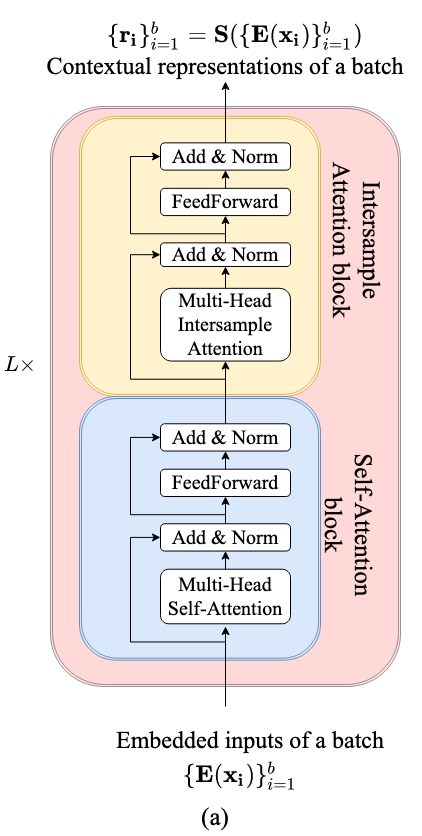

# Real-Time IDS in 5G Networks: A Self-Supervised Transformer Approach based on Temporal Windowing

This repository contains a Python project aimed to explore advanced techniques for detecting cyber threats by simulating real-time network traffic streams.

The model is trained exclusively on benign (physiological) network traffic and is designed to identify malicious packets using a dual-branch **Self-Supervised Learning (SSL)** approach, demonstrating its ability to understand the complex relationships between spatial and temporal traffic features.

## 📖 Project Description

This repository contains the implementation developed for the Master's Thesis project focused on Intrusion Detection Systems (IDS) for 5G telecommunication networks.

The research addresses the critical challenge of Zero-Day anomaly detection in modern 5G environments. Traditional supervised IDS often struggle with previously unseen attacks and rely heavily on extensively labeled datasets. This project overcomes these limitations by introducing a purely unsupervised framework that leverages a Transformer architecture adapted for tabular network streams.

By grouping network packets into discrete temporal windows, the model simulates a real-time ingestion stream. It learns the physiological baseline of the network through two self-supervised tasks:

* **Feature Masking & Reconstruction**: Predicting missing components within network packets.
* **Contrastive Learning (Tabular MixUp)**: Maximizing agreement between augmented views of the same temporal window via MixUp and InfoNCE loss.

In the Validation phase, the model processes strictly benign traffic to establish a statistical baseline of normal behavior. It computes a spatial centroid in the latent space and calculates a hybrid anomaly threshold (combining Reconstruction Error and Cosine Distance) based on a specified statistical percentile.

At Inference time, the model evaluates continuous streams of unknown traffic, which include both benign packets and malicious traffic. It extracts the anomaly features, normalizes them strictly using the parameters learned during validation, and flags any temporal window that exceeds the hybrid threshold as a malicious intrusion.

## 🏗️ Model Architecture

Model Architecture is illustrated below:

<center>
    
<p style = "font-size: 16px;
            font-family: 'Georgia', serif;
            text-align: center;
            margin-top: 10px;">Source: <a href = "https://arxiv.org/pdf/2106.01342">SAINT: Improved Neural Networks for Tabular Data
via Row Attention and Contrastive Pre-Training</a>
</center>

The architecture is inspired by the **SAINT** (Self-Attention and Intersample Attention Transformer) model, adapted to operate on tabular network traffic streams.

* **Tabular Tokenizer**: Projects mixed-type categorical and continuous features into a unified embedding space.
* **Attention Mechanisms**: The self-attention layers are highly configurable and structured to capture two fundamental dimensions:

  1. **Intra-Sample Attention**: Computes attention across features of the same network flow, learning the internal context of a single packet.
  2. **Inter-Sample Attention**: Computes attention across packets within the same temporal window, capturing temporal patterns and stream evolution over time.

Padding is rigorously handled via boolean masks to prevent the introduction of mathematical noise.

## 📊 Dataset

The project utilizes the 5G-NIDD dataset that consists of a comprehensive collection of network traffic generated within a fully functional 5G testbed environment. It includes both benign (physiological) traffic and a wide variety of modern cyberattacks (such as DoS, DDoS, and port scanning), making it an ideal benchmark for evaluating 5G-specific intrusion detection systems. The processing pipeline handles the entire data lifecycle:

1.  **Cleaning**: Zero-filling for missing protocol metrics and the removal of noisy columns.
2.  **Categorical Encoding**: An ordinal encoder (with safe *Out-Of-Vocabulary* handling) converts network protocols and states for the embedding layers.
3.  **Balanced Splitting**: Sequential undersampling of attacks is applied to ensure a balanced and realistic test set.

## 📂 Project Structure

```text
.
├── 5G-NIDD/                # Folder containing the original dataset.
├── main.py                 # Main script: pipeline orchestration and experimental execution.
├── dataset.py              # Data preprocessing and temporal windowing.
├── model.py                # Model architecture: Tokenizer, SAINTLayer, and Attention mechanisms.
├── training.py             # Self-Supervised logic (InfoNCE, MixUp, Feature Masking).
├── validation.py           # Calculation of the hybrid threshold and benign centroid.
├── evaluation.py           # Inference, feature extraction, and metrics.
├── utils.py                # Support functions, Early Stopping, and plotting.
├── config.py               # Configurator class to centralize hyperparameters.
├── requirements.txt        # Python dependencies needed to run the project.
└── README.md               # This file, providing project documentation[cite: 9].

```

## 🚀 Installation and Usage

Follow these steps to set up and run the project.

### 1. Clone the repository


```bash
git clone https://github.com/Michelemata/IDS-Transformer.git
cd IDS-Transformer

```

### 2. Install dependencies


It is recommended to create a virtual environment.

```bash
python -m venv venv
source venv/bin/activate  # On Windows: venv\Scripts\activate
pip install -r requirements.txt

```

### 3. Run the main script


To start the entire process (from preprocessing and data collection to training and benchmarking), run:

```bash
python main.py

```

* **Data Configuration**: Modify the `dataset_path` in `config.py` to point to your local CSV file.
* **Results**: Upon completion, the following will be saved:

  * KDE plots of the anomaly score distributions.
  * Confusion matrices (saved in the root directory).
  * A `Benchmark_Table.csv` file containing the final performance results across different temporal windows.


## ⚙️ Configuration

All hyperparameters for the model, training, file paths, and memory optimizations can be modified in the `Configurator` class within `config.py`.

## 📈 Evaluation

The model's performance is evaluated on the Test set (simulating a Zero-Day attack scenario). The main metrics used are:

* **Classification**: F1-Score, Precision, Recall, and Accuracy.
* **Ranking**: Area Under the Curve (AUC).
* **Real-Time Metrics**: Inference latency (measured in milliseconds per temporal window) to evaluate the model's viability in production environments.

## Acknowledgements

This project was carried out as a **Master's Thesis** in **Network Security**, under the supervision of Professor **Giuseppe Piro** at the **Politecnico di Bari**.

## 📜 License

This project is released under the MIT License. See the `LICENSE` file for more details.